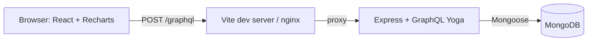

# Ledgerly

**A personal finance tracker built on the MERN stack with a GraphQL API.** Log expenses and income, see where your money goes on interactive charts, set monthly budgets per category, and get plain-English insights such as "Shopping is up 85% from last month".

## Features

- **Expense and income tracking** with categories, payment method (UPI, card, cash, bank transfer, wallet), notes and dates
- **Interactive dashboard**: spending by category (donut chart), daily spending, 6-month income vs expense trend, payment-method breakdown
- **Monthly budgets** per category with progress bars that turn amber at 80% and red when exceeded
- **Automatic insights**: savings rate, overspending, month-over-month change, category spikes, budget alerts
- **Search, filter and paginate** transactions by type, category, date range and note text
- **Multi-user and secure**: bcrypt password hashing, JWT in an httpOnly cookie, every query scoped to the logged-in user, login rate limiting
- **One GraphQL request per screen**: the dashboard loads summary, trend, budgets and insights in a single round trip

## Architecture



The heavy lifting (totals, per-category sums, daily and monthly grouping) runs inside MongoDB as **aggregation pipelines**, so the API receives a handful of summary rows instead of every transaction.

## Tech stack

| Layer | Technology |
|---|---|
| Frontend | React 19, TypeScript, Vite, React Router, Recharts |
| API | Node.js 22, Express 5, GraphQL (GraphQL Yoga), Zod validation |
| Database | MongoDB 7 with Mongoose, compound indexes, aggregation pipelines |
| Auth | bcrypt, JWT in httpOnly SameSite cookie, rate limiting |
| DevOps | Docker, Docker Compose, nginx, GitHub Actions |
| Testing | Vitest |

## Quick start (Docker)

You need Docker Desktop.

```bash
cp .env.example .env        # then set JWT_SECRET to a long random string
docker compose up --build
docker compose exec server node dist/scripts/seed.js    # demo data (in a second terminal)
```

Open http://localhost:8080 and log in with **demo@ledgerly.app / Demo@1234**. The demo account has four months of transactions and budgets for the current month.

## Running locally (for development)

```bash
docker compose up mongo -d      # only the database

cd server
npm install
npm run seed
npm run dev                     # API + GraphiQL playground on http://localhost:4000/graphql

cd ../web                       # in a second terminal
npm install
npm run dev                     # app on http://localhost:5173
```

Commit both `package-lock.json` files after the first `npm install`. CI uses `npm ci`, which needs them.

## Try the API in GraphiQL

In development, open http://localhost:4000/graphql. Log in through the app first (same browser, so the cookie is sent), then run:

```graphql
query {
  monthSummary(month: "2026-10") {
    income
    expense
    savingsRate
    byCategory { category amount share }
  }
  insights(month: "2026-10") { severity message }
}
```

## Tests

```bash
cd server
npm test     # money conversion, date handling, insight rules, rate limiter
```

## Project structure

```
server/src/
  graphql/typeDefs.ts       GraphQL schema
  graphql/resolvers.ts      queries and mutations, input validation, auth checks
  services/analytics.ts     MongoDB aggregation pipelines
  services/insights.ts      rules that turn numbers into insights (pure, unit tested)
  models/                   User, Transaction, Budget (Mongoose)
  lib/                      money (paise), dates, categories, rate limiter
  scripts/seed.ts           demo account with realistic data
web/src/
  pages/                    Dashboard, Transactions, Budgets, Login/Register
  components/               layout, month picker, transaction form, progress bar
  lib/graphql.ts            tiny GraphQL client + useQuery hook
```

## What I would add next

- Recurring transactions (rent, subscriptions) created automatically each month
- CSV import from bank statements and CSV export
- DataLoader and query cost limits if the schema grows nested relationships
- Refresh tokens and "log out of all devices"
- End-to-end tests with Playwright
